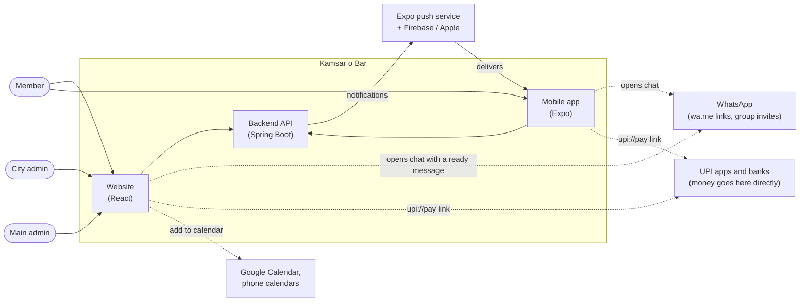
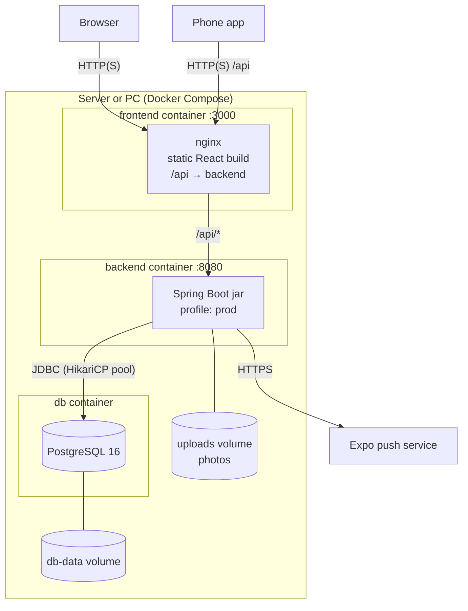
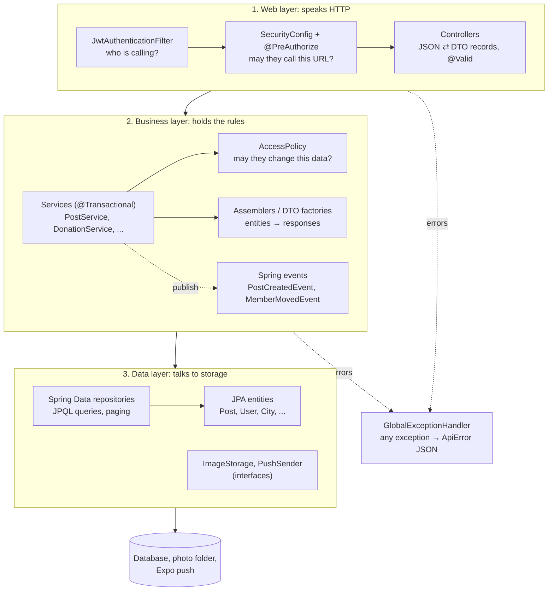
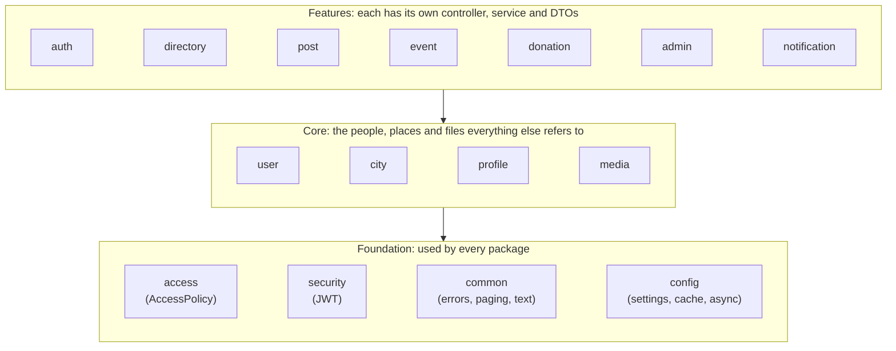

# Architecture

This document describes how Kamsar o Bar is designed and why. To follow a request through the code, read [CODE_FLOW.md](CODE_FLOW.md) for the overview, then [TUTORIAL.md](TUTORIAL.md) for a step-by-step walk through the real code.

## Contents

- [Architecture design](#architecture-design)
  - [Goals and how the design meets them](#goals-and-how-the-design-meets-them)
  - [System context](#system-context)
  - [Deployment](#deployment)
  - [Layers inside the backend](#layers-inside-the-backend)
  - [How the feature packages depend on each other](#how-the-feature-packages-depend-on-each-other)
  - [Cross-cutting concerns](#cross-cutting-concerns)
  - [Key design decisions](#key-design-decisions)
- [Backend layout: package by feature](#backend-layout-package-by-feature)
- [SOLID in practice](#solid-in-practice)
- [Scalability](#scalability)
- [Security](#security)
- [Data model](#data-model)
- [Extending](#extending)
- [Mobile app](#mobile-app)

## Architecture design

Kamsar o Bar is a **modular monolith**:
- **One backend.** A single Spring Boot application, split inside into one package per feature.
- **Two clients.** A React website and an Expo mobile app, both calling the same REST API.
- **One database.** PostgreSQL.

This keeps it cheap to run (one server can hold all of it) and simple for one person to maintain. It can still grow: the backend keeps no session, so it can run as several copies.

### Goals and how the design meets them

| Goal | Design choice |
| --- | --- |
| Members are grouped by city | Every user, post, cause and donation carries a `city_id`. One class, `PostAudience`, decides which city's posts a viewer may see. |
| Works on a home PC or a small server | One backend jar plus one database. In development an embedded H2 database means nothing needs installing. |
| Can grow when the community grows | The API is stateless (a JWT login token on each request), so several backend copies can run behind nginx. Every list is paged, and totals are summed in the database. |
| Website and phone app share all features | One REST/JSON API. Both clients are just screens. All rules live in the backend. |
| Easy to change safely | One package per feature, and the SOLID principles. The parts most likely to change sit behind small interfaces: storage, push, tokens, permissions and search. Integration tests cover each feature through the real API. |
| Never hold anyone's money | Money goes straight to each city's bank or UPI account. The app only records contributions, and the city admin verifies them. |
| Admin powers are limited and safe | Three roles (member, city admin, main admin). Every permission rule lives in `AccessPolicy`. Blocking hides content but deletes nothing. |

### System context

Who uses the system, and which outside services it relies on:

The app never sends WhatsApp messages or payments itself. It builds a link, and the member's own WhatsApp or UPI app does the rest. That is why it needs no WhatsApp Business account and no payment gateway.

### Deployment

`docker compose up` runs this layout on any machine. A cloud server runs the same thing.

- **Development.** `mvn spring-boot:run` starts the backend with an H2 file database in `backend/data/`, and `npm run dev` serves the website on port 5173, forwarding `/api` to port 8080.
- **Scaling out.** Add more backend containers behind nginx or a load balancer. Each copy then needs a shared photo store: either an object-storage `ImageStorage` (S3, Google Cloud Storage, Cloudflare R2) or a shared volume.
- **Configuration.** Everything is set by environment variables (database, `JWT_SECRET`, admin account, push provider). The README lists them.

### Layers inside the backend

Every request goes down the same layers, and each layer only calls the one below it:

| Layer | Its one job | Must not |
| --- | --- | --- |
| Controller | Turn HTTP into a call: path, query, JSON body → a DTO, then the result → JSON | Contain rules or touch repositories |
| Service | Business rules, permissions (through `AccessPolicy`) and the transaction | Know about HTTP |
| Repository | Read and write rows, with paged queries | Contain rules |
| Entity | Map one table, with small methods that keep its own data consistent (`post.edit(...)`, `user.makeCityAdmin(...)`) | Be returned to the client (DTOs are returned instead) |

### How the feature packages depend on each other

Each folder under `backend/src/main/java/com/kamsarobar/` is one package. They sit in three tiers, and dependencies point downward. There are two small exceptions: a photo (`media`) knows which post it belongs to, and `access` reads the `Role` type from `user`.

| Package | Uses (besides the foundation) |
| --- | --- |
| `auth` | `user`, `city` |
| `directory` | `profile`, `user`, `city` |
| `post` | `user`, `city`, `media` |
| `event` | `post` |
| `donation` | `user`, `city` |
| `admin` | `user`, `city`, `post`, `profile`, `donation` |
| `notification` | `post`, `user` |
| `profile` | `user` |
| `media` | `post` (a photo is attached to a post) |
| `user`, `city` | `city` only (a user lives in a city) |

Two links between packages are **Spring events**, not direct calls:
- `UserService` publishes a `MemberMovedEvent` without knowing that posts exist.
- `PostService` publishes a `PostCreatedEvent` without knowing that notifications exist.

New reactions to the same events can be added without touching the publisher.

### Cross-cutting concerns

| Concern | Where it lives | How it works |
| --- | --- | --- |
| Who is calling | `security/JwtAuthenticationFilter`, `JwtTokenService` | Reads the JWT, reloads the user by id on every request, and ignores blocked users. |
| May they call this URL | `config/SecurityConfig`, `@PreAuthorize` on admin controllers | Lists the public URLs (login, register, city list, photos, health). Everything else under `/api` needs a login, and admin controllers also check the role. |
| May they change this data | `access/AccessPolicy` | `canModifyContent`, `canManageCity` and `canBlockMember`, called by services. |
| Who may see a post | `post/PostAudience` | The same rule as a Java check (`canSee`) and as a JPQL filter (`JPQL_FILTER`). |
| Input checks | DTO records (`@NotBlank`, `@Size`, `@Pattern`) plus checks in services | Bad input becomes 400 with `fieldErrors`, or a `BadRequestException` with a message. |
| Errors | `common/exception/GlobalExceptionHandler` | Every error becomes `{ status, error, message, fieldErrors, code }`. Unexpected errors are logged and return a polite 500. |
| Transactions | `@Transactional(readOnly = true)` on each service class, `@Transactional` on write methods | A failure undoes the whole change. |
| Background work | `config/AsyncConfig`, `@Async`, `@TransactionalEventListener`, `@Scheduled` | Notifications go out after commit, reminders every 5 minutes, photo cleanup hourly. |
| Caching | `config/CacheConfig` (Caffeine) | The city list is cached and evicted when a city changes. |
| Settings | `application.yml`, `config/AppProperties` | Typed settings from environment variables. Profiles: `dev` (H2), `test`, `prod` (PostgreSQL). |
| Database changes | `db/migration/V*.sql` (Flyway) | Versioned SQL. Hibernate only validates the schema. |
| Health | Spring Boot Actuator | `/actuator/health`, plus liveness and readiness checks. |

### Key design decisions

| Decision | Chosen | Instead of | Why |
| --- | --- | --- | --- |
| Overall shape | Modular monolith | Microservices | One person maintains it and there is one thing to deploy. Packages are already separated, so one could be split out later. |
| API style | REST with JSON | GraphQL, server-rendered pages | The website and the app share it unchanged, and it's easy to test and to read in the browser. |
| Login | Stateless JWT, user reloaded per request | Server sessions | Any backend copy can serve any request, and blocks and role changes still apply at once. |
| Database | PostgreSQL with Flyway, H2 for development | MySQL, MongoDB | The data is relational (cities → users → posts) and totals need SQL aggregation. Free to run. |
| Website | React single-page app built by Vite, served by nginx | Next.js, server templates | Plain static files are cheap to host and work with any CDN. |
| Mobile | React Native with Expo | Flutter, two native apps | Same language and patterns as the website, one code base for Android and iOS, and push notifications included. |
| Photos | Shrunk on the device, saved through `ImageStorage` | Resizing on the server, cloud storage from day one | Saves members' mobile data and server CPU. Moving to S3 later is one new class. |
| Donations | Direct bank or UPI transfer, verified by the city admin | A payment gateway | No fees and no payment compliance work. A gateway can plug into the same `review(...)` step later. |
| Notifications | Expo push, sent in the background after commit | Firebase directly, the app polling | Free, one API for Android and iOS, and posting stays fast. |
| Permissions | One `AccessPolicy` | Role checks spread through services | Every rule is in one place, readable and unit-tested. |
| Post visibility | `PostAudience` used by both Java and the database query | Filtering in Java after loading | Hidden rows are never loaded, so paging stays correct and nothing leaks. |

## Backend layout: package by feature

Each feature is a self-contained package with its own entity, repository, service, controller and DTOs:

| Package | Responsibility |
|---|---|
| `auth` | Register (form 1) and log in, issuing a JWT |
| `user` | `User` entity, `Role` (MEMBER / CITY_ADMIN / MAIN_ADMIN), editing basic info and password |
| `profile` | `UserProfile` (form 2), and the `Company` and `Skill` tag tables with autocomplete |
| `directory` | "Who can refer me to X?" and "Who knows Y?" search |
| `post` | Posts (text, photos, seminars and events) and comments, with ownership and moderation rules. Event attendees. `PostResponseAssembler` builds a whole page of responses with a fixed number of queries. `MemberPostsMover` moves a member's city-only posts when they change city: `UserService` publishes a `MemberMovedEvent` and doesn't need to know about posts. |
| `event` | "My upcoming events" and discovering upcoming events and seminars |
| `notification` | Push notifications: registered phones, members' choices, who is notified about a new post or event, and the event reminder job. Sending goes through a `PushSender` interface, with an Expo implementation by default. |
| `media` | Photo upload, validation by file contents, storage behind the `ImageStorage` interface, and an hourly cleanup of unused photos |
| `donation` | Donations (pending → verified/rejected), campaigns, city-wise totals |
| `city` | Cities, WhatsApp group link, bank details |
| `admin` | Main admin operations: appoint or revoke city admins (one per city), move members between cities, manage cities, list members |
| `access` | **All authorisation rules in one place** |
| `security` | JWT filter and token service |
| `common` | Error handling, paging, text and phone normalisation |

Controllers are thin (HTTP ↔ DTO). Services hold the business logic and transactions. Repositories only do data access.

## SOLID in practice

**S: Single Responsibility.**
- `AuthService` only registers and logs in. `UserService` only edits users. `ProfileService` only handles form 2.
- `PhoneNumberNormalizer` only normalises numbers. `TextNormalizer` only cleans text. `GlobalExceptionHandler` only maps errors to HTTP responses.
- Authorisation lives in `AccessPolicy`. Services ask *"may this user do this?"* instead of each re-implementing role checks.

**O: Open/Closed.**
- Search is built on `DirectorySearchStrategy`. `ReferralSearchStrategy` and `ExpertiseSearchStrategy` are two implementations. `DirectoryService` receives every strategy bean from Spring and picks one by `SearchType`. To add a new search (say, "by current position"), you add one class and the existing code doesn't change.
- Photo storage is behind `ImageStorage`. `FileSystemImageStorage` is the default. Adding an S3 or Google Cloud Storage implementation needs no other code changes.
- `TagResolver<T>` is one generic find-or-create-and-suggest implementation used for both companies and skills. A new tag type, such as *colleges*, is one entity, one repository and one bean.
- On the frontend, `DirectorySearch` is a generic component. *Find referral* and *Find expert* are just configuration objects (labels, API call, message builder).

**L: Liskov Substitution.** Every `DirectorySearchStrategy` and every `TagRepository` subtype can be used wherever the base type is expected, without special cases. `RoleBasedAccessPolicy` can be swapped for any other `AccessPolicy` implementation.

**I: Interface Segregation.** Interfaces are small and focused. `TokenService` has two methods. `AccessPolicy` has two questions plus helpers. `DirectorySearchStrategy` has two methods. On the frontend each resource has its own small API object (`postApi`, `donationApi`...), so pages depend only on what they use.

**D: Dependency Inversion.**
- Services depend on abstractions such as `TokenService` (not JJWT directly), `AccessPolicy` (not role checks) and `PasswordEncoder`. All of them are wired through constructor injection.
- `JwtAuthenticationFilter` depends on `TokenService`. You could switch to opaque tokens or OAuth without touching the filter's callers.

## Scalability

| Concern | How it's handled |
|---|---|
| **Horizontal scaling** | The API is **stateless**: JWT auth with no HTTP session, so you can run any number of backend instances behind a load balancer. |
| **Database growth** | PostgreSQL with indexes on every foreign key and search path (`users.city_id`, `posts(city_id, created_at)`, `donations(city_id, status)`, the tag join tables...). Company and skill names are **normalised into their own tables** with a unique lower-case key, so search is a join on a short indexed table instead of scanning free text. |
| **Large result sets** | Every list endpoint is **paginated**. Page size is capped at 50 server-side (`Pages`). |
| **N+1 queries** | `@EntityGraph` fetches authors and cities with posts. Comment counts for a whole feed page come from **one grouped query**. Hibernate batch fetching (`default_batch_fetch_size: 50`) handles collections. |
| **Aggregations** | Donation totals are computed with `SUM … GROUP BY` **in the database**, not in Java. |
| **Photos** | Shrunk in the **browser** to 3 MB or less before upload. That saves members' mobile data, server bandwidth and storage. The server checks the size and the real file type again. Photos are served with `Cache-Control: immutable` (cache forever), so a CDN or nginx can serve repeat views. For several backend instances, use an object-storage `ImageStorage` (S3, GCS, Cloudflare R2) or a shared volume. |
| **Feeds** | Comment counts, attendee counts and the viewer's "going" flags for a page of posts come from **3 grouped queries in total**, not one per post. Photos are batch-fetched. |
| **Notifications** | Sent in the **background after the post is saved** (`@Async` and `@TransactionalEventListener(AFTER_COMMIT)`), so posting stays fast. Audiences are read 500 phones at a time and sent to Expo 100 per request. Phones where the app was uninstalled are removed automatically. Reminders are claimed with a single conditional `UPDATE`, so several backend instances never send the same reminder twice. |
| **Read-heavy data** | The city list is cached (Caffeine) and evicted on change. For several instances, set `spring.cache.type=redis` and add the Redis starter. No code change is needed. |
| **Schema changes** | Versioned **Flyway** migrations (`db/migration/V*.sql`). Hibernate only *validates* the schema and never alters it. |
| **Operations** | `/actuator/health` (with liveness and readiness probes for Kubernetes), graceful shutdown, a connection-pool size set by environment variable, and Docker images that run as a non-root user. |
| **Frontend** | A static build served by nginx with gzip and long-term caching of hashed assets. It can also go on any CDN. |

Next steps when traffic grows:
- Add PostgreSQL **read replicas** and route read-only transactions there (the services are already marked `@Transactional(readOnly = true)`).
- For very large member counts, put referral and expert search on **PostgreSQL trigram indexes** (`pg_trgm`) or a search engine such as OpenSearch, as a new `DirectorySearchStrategy`.
- Add **rate limiting** on `/api/auth/*`, at the nginx or gateway level.

## Security

- Passwords are hashed with BCrypt. The JWT is signed with HMAC-SHA (HS256, HS384 or HS512, depending on the length of the `JWT_SECRET` you provide).
- The user is reloaded from the database on every request (a primary-key lookup), so **revoking a city admin takes effect immediately** instead of waiting for the token to expire.
- Authorisation rules:
  - Authors can change their own posts and comments.
  - City admins can moderate their own city and manage its settings, donations and causes. They can't change their own city; only the main admin can move them.
  - The main admin can do everything.
  - `/api/admin/**` is restricted with `@PreAuthorize("hasRole('MAIN_ADMIN')")`.
- **Blocking** is checked on every request. The JWT filter reloads the user and refuses blocked accounts, so a block takes effect immediately rather than when the token expires. The block rule is in `AccessPolicy.canBlockMember`. Hiding a blocked member's content uses the same `PostAudience` filter and comment queries, so it's reversible and nothing is deleted.
- Post visibility ("only my city" or "everyone") is enforced on the server, never just hidden in the page. The rule lives in one class, `PostAudience`. It provides a Java check for single posts and the matching query filter, so feed, event and comment requests never load a post the viewer may not see. A post that's hidden from someone returns 404, so its existence doesn't leak.
- Input is validated with Bean Validation, for example on WhatsApp links, IFSC codes, UPI IDs, LinkedIn URLs and amount limits. LIKE wildcards in search terms are escaped.
- Mobile numbers are visible only to logged-in members. Members can opt out of search.

## Data model

The tables, their relations and the migration history are drawn in [CODE_FLOW.md → Data model](CODE_FLOW.md#data-model). The city is at the centre: users, posts, causes and donations each carry a `city_id`, and a city admin is a user whose `managed_city_id` points at a city.

## Extending

- **OTP login or password reset.** Add an `OtpSender` interface (with an SMS or WhatsApp Business API implementation) and an `/api/auth/otp` flow in `auth`. The rest of the app only sees `TokenService`.
- **Online payments.** Today money goes directly to the city bank account and the admin verifies it. To accept payments in-app, add a `PaymentGateway` interface (for example Razorpay) in `donation`. Its webhook would call the same `review(...)` method to mark a donation as verified.
- **More notifications.** Publish more Spring events from the services (for example `DonationVerified` or `CommentAdded`) and handle them in `notification`, the same way `PostCreatedEvent` is handled today.

## Mobile app

The mobile app is a React Native app built with Expo SDK 57 and Expo Router. It lives in its own repository, [pycharm0422/kamsarobar-mobile](https://github.com/pycharm0422/kamsarobar-mobile). It uses the same REST API as the website, and its API layer, link builders (WhatsApp, UPI, calendar) and photo-size rules mirror the website's.

- The login token is kept in the phone's secure storage.
- Push tokens are registered after login and removed on logout.
- Tapping a notification opens the post it's about, including when the app was closed.

Setup and build instructions are in that repository's README.
