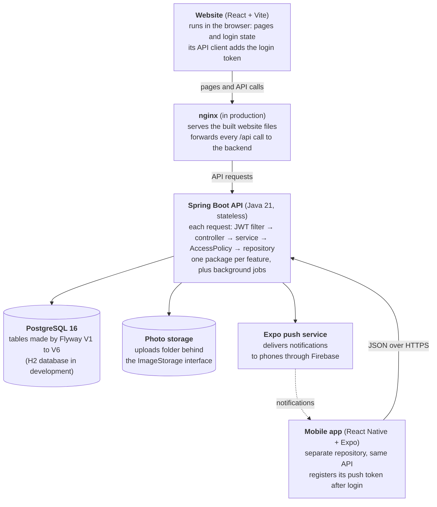
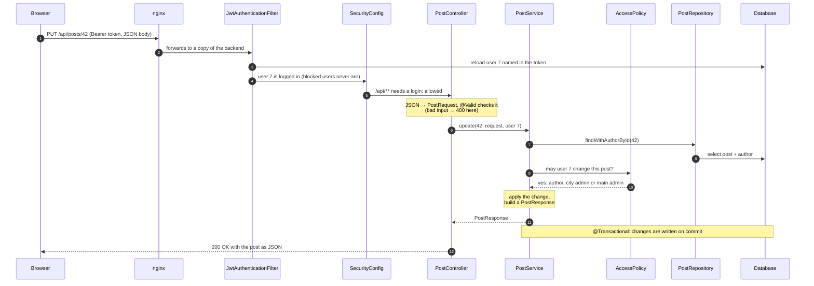
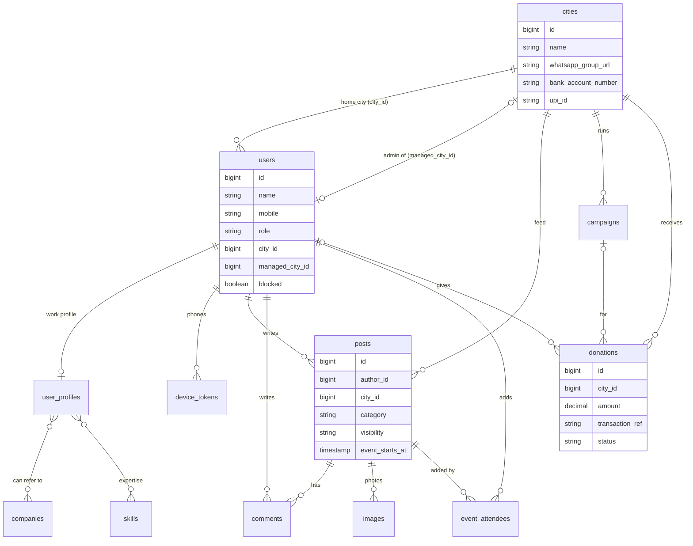

# Kamsar o Bar: Code flow and build guide

This guide explains how the code is organised, how a request travels through it, and the order the application was built in. For a slower, line-by-line walk through the real code, read [TUTORIAL.md](TUTORIAL.md). For the design decisions behind it, read [ARCHITECTURE.md](ARCHITECTURE.md).

## Contents

1. [Big picture](#big-picture)
2. [How the application was built, step by step](#how-the-application-was-built-step-by-step)
3. [Backend code flow: the life of one request](#backend-code-flow-the-life-of-one-request)
4. [Key flows, traced end to end](#key-flows-traced-end-to-end)
5. [Website (React) code flow](#website-react-code-flow)
6. [Mobile app (Expo) code flow](#mobile-app-expo-code-flow)
7. [Data model](#data-model)
8. [Build, test and run](#build-test-and-run)
9. [Recipe: adding a new feature](#recipe-adding-a-new-feature)

## Big picture

Kamsar o Bar is three programs sharing one database:
- The **backend** (Spring Boot) holds all the rules and data.
- The **website** (React) and the **mobile app** (Expo) are two screens on top of the same REST API.

Neither the website nor the app talks to the database directly.



Every request carries a login token, so any copy of the backend can answer it. That is why the backend can run as several copies behind nginx when traffic grows.

## How the application was built, step by step

The app was built from the bottom up: database first, then security, then one feature package at a time, then the website, then the mobile app. Each step only uses what the steps before it built. The commit history on GitHub follows the same order.

**Part 1: the foundation (backend)**

1. **Project skeleton.** A Spring Boot 3.5 project on Java 21 in `backend/` (built with Maven), and a React 19 project built with Vite in `frontend/`.
2. **Database schema.** Flyway migration `V1__init_schema.sql` creates the first tables: cities, users, profiles, companies, skills, posts, comments, campaigns and donations. `V2__seed_cities.sql` adds the starter list of cities. Development uses an H2 file database in PostgreSQL mode, so nothing needs installing. Production uses PostgreSQL 16.
3. **Shared building blocks** in `common/`:
   - exception classes and a single `GlobalExceptionHandler` that turns any error into the same JSON shape (`ApiError`);
   - paging helpers (`PageResponse`, `Pages`, page size capped at 50);
   - `PhoneNumberNormalizer` (adds +91 to 10-digit numbers) and `TextNormalizer`.
4. **Users and login** in `user/`, `auth/` and `security/`:
   - the `User` entity and `Role` (MEMBER, CITY_ADMIN, MAIN_ADMIN);
   - BCrypt password hashing;
   - `JwtTokenService`, which issues and checks login tokens;
   - `JwtAuthenticationFilter`, which reads the token on every request;
   - `SecurityConfig`, which decides which URLs are public;
   - `AuthService` for register (form 1) and login;
   - `BootstrapAdminInitializer`, which creates the main admin on first start.
5. **One place for permissions.** `AccessPolicy` (implemented by `RoleBasedAccessPolicy`) answers questions like "may this user edit this post?", so no service writes its own role checks.

**Part 2: the features (backend)**

6. **Cities.** Each city holds its WhatsApp group link and bank details. The city list is cached with Caffeine.
7. **Professional profile (form 2).** `UserProfile` plus the `Company` and `Skill` tag tables. One generic `TagResolver` finds or creates tags and suggests names as you type, so everyone spells "Google" the same way.
8. **Referral and expert search.** `DirectoryService` picks a `DirectorySearchStrategy`: `ReferralSearchStrategy` searches by company and `ExpertiseSearchStrategy` by expertise.
9. **Posts and comments.** `PostService` and `CommentService`. The author, the city's admin and the main admin may edit or delete.
10. **Donations and causes.** A member records a donation as PENDING, and the city admin verifies or rejects it. Totals are summed in the database.
11. **Main admin tools.** Appoint and remove city admins, manage cities, list members.

**Part 3: the website**

12. **Website.** First an axios API client that attaches the token and an `AuthContext` that remembers who is logged in. Then one page per feature and shared components (search, member card, WhatsApp composer).

**Part 4: features added later, each with its own migration**

13. **Photos, seminars and events** (`V3`). The browser shrinks photos to 3 MB or less, and `ImageStorage` saves them. Event dates and an attendees table power *My upcoming events*.
14. **Who can see a post** (`V4`). Each post is CITY or EVERYONE. One class, `PostAudience`, holds the rule.
15. **Blocking members** (`V5`). Admins can block a member, which logs them out and hides their content without deleting it.
16. **Push notifications** (`V6`). Phones register a push token. Notifications about new posts and events, and event reminders, are sent in the background after the post is saved.
17. **Mobile app.** A React Native (Expo) app in its own repository that uses the same API.
18. **City admin rules.** One admin per city, and city admins can't move themselves. When a member changes city, their city-only posts move with them.

Tests and documentation were added at each step, and Docker Compose packages the database, backend and website.

## Backend code flow: the life of one request

Every backend feature follows the same path, so once you can follow one request you can follow them all. Each layer has one job:
- the **controller** speaks HTTP;
- the **service** holds the rules;
- **AccessPolicy** decides permissions;
- the **repository** talks to the database.

Example: a member edits post 42 with `PUT /api/posts/42`.



An error thrown at any step jumps straight to `GlobalExceptionHandler`, which returns the same JSON shape every time (`ApiError`):

| What went wrong | Status |
| --- | --- |
| Invalid input | 400, with `fieldErrors` |
| No login or a bad token | 401 |
| Not allowed | 403 |
| Not found, or hidden from you | 404 |
| A conflict, such as a city that already has an admin | 409, with `code: CITY_HAS_ADMIN` |

Because the service method is `@Transactional`, a failure also undoes any half-made change.

## Key flows, traced end to end

Each flow below starts with what the member does and follows the code to the database and back. File names are relative to `backend/src/main/java/com/kamsarobar/` or `frontend/src/`.

### Register and log in

1. `RegisterPage.jsx` sends name, mobile, city and password to `POST /api/auth/register`.
2. `AuthService.register` cleans the mobile number with `PhoneNumberNormalizer`, so `98765 43210` becomes `919876543210`. It then refuses a number that is already registered (409).
3. The password is hashed with BCrypt, and the `User` is saved with role MEMBER.
4. `JwtTokenService` signs a token holding the user's id. The response is `{ token, user }`.
5. The website stores the token in `localStorage` (`api/client.js`). From then on axios adds `Authorization: Bearer <token>` to every request.
6. On every later request, `JwtAuthenticationFilter` reads the id from the token, reloads the user from the database and refuses blocked users. That reload is why a block or a role change works immediately.
7. Login (`POST /api/auth/login`) works the same way, but checks the password with `passwordEncoder.matches`.

### Find a referral and open WhatsApp

1. `FindReferralPage.jsx` uses the shared `DirectorySearch` component and calls `GET /api/directory/referrers?company=goog`.
2. `DirectoryController` passes the request to `DirectoryService`. That service receives every `DirectorySearchStrategy` bean and picks `ReferralSearchStrategy` by `SearchType`.
3. The strategy runs a query in `UserProfileRepository`. It finds members who:
   - are open to help;
   - are not blocked;
   - are not the person searching;
   - list a referral company whose name matches `%goog%`.

   Company names are stored lower-case in their own table, so this is a short, indexed match.
4. Each result comes back as a `MemberCard` with the mobile number in WhatsApp format.
5. Clicking **Ask for referral** opens `WhatsAppComposer`. `utils/whatsapp.js` writes the message (company, job role, job link, your LinkedIn) and builds a `https://wa.me/<mobile>?text=...` link, which opens WhatsApp.

### Post with photos, and the notifications that follow

1. In `PostForm.jsx`, each chosen photo goes through `prepareImage` (`utils/imageResize.js`). Photos up to 3 MB are kept as they are. Bigger ones are redrawn on a canvas at their original proportions and saved as high-quality JPEG until they fit.
2. Each photo is uploaded on its own to `POST /api/images`. `ImageService` checks the real file type from the file's first bytes (`ImageFormat.detect`) and stores it through `ImageStorage` (`FileSystemImageStorage` by default). It returns an image id.
3. The post is sent to `POST /api/posts` with its text, visibility (CITY or EVERYONE), category, optional event fields and the image ids.
4. `PostService.create` checks the input, saves the `Post` in the author's city, attaches the images and publishes a `PostCreatedEvent`.
5. After the database transaction commits, `NotificationService.onPostCreated` runs in the background (`@Async`). It reads the phones that should hear about it 500 at a time, and `ExpoPushSender` sends them to Expo in batches of 100.
6. Every 5 minutes a scheduled job sends reminders for events starting within the next hour. Every hour another job deletes photos that were uploaded but never attached to a post.

### The feed and who can see a post

1. `PostsPage.jsx` calls `GET /api/posts?cityId=<city>`. The city defaults to the viewer's own.
2. The repository query has two filters:
   - the **city filter** keeps posts from that city plus every EVERYONE post from any city;
   - the **audience filter** (`PostAudience.JPQL_FILTER`) hides posts the viewer may not see.
3. A viewer may see a post if any of these is true:
   - it's for everyone;
   - it's from their own city;
   - they are the admin of its city;
   - they wrote it;
   - they are the main admin.

   Posts by blocked members are always hidden.
4. `PostResponseAssembler` builds the whole page with a fixed number of grouped queries (comment counts, attendee counts, "am I going"), not one query per post.
5. Opening one post (`GET /api/posts/{id}`) applies the same rule in Java (`PostAudience.canSee`). A hidden post returns 404, so outsiders can't tell it exists.

### Donate and verify

1. `DonatePage.jsx` shows the city's bank details and UPI ID. On a phone, **Pay with a UPI app** opens a `upi://pay` link.
2. The member then records the amount and transaction reference with `POST /api/donations`. It's saved as PENDING.
3. The city admin opens **Admin → Donations** and compares entries with the bank statement. `PATCH /api/donations/{id}/status` calls `DonationService.review`, which first checks `accessPolicy.requireCityManager`.
4. Totals come from a `SUM ... GROUP BY` query in `DonationRepository`, counting VERIFIED donations only.

### City admins and moving members

1. The main admin appoints an admin through `POST /api/admin/city-admins`, handled by `AdminService.assignCityAdmin`.
2. If the city already has an admin, the server answers 409 with code `CITY_HAS_ADMIN`. The website's `withAdminReplacement` helper (`utils/adminActions.js`) asks whether to replace them, then retries with `replaceExistingAdmin: true`.
3. Moving a member (`PUT /api/admin/members/{id}/city`) goes through `UserService.moveToCity`. It's the only place a member's city changes, and city admins can't call it for themselves.
4. `moveToCity` publishes a `MemberMovedEvent`. `MemberPostsMover`, in the post package, moves the member's city-only posts in the same transaction. Upcoming events stay where they are.

## Website (React) code flow

The website is a single-page app. The browser loads it once, and from then on every screen change happens in the browser, with only JSON going to the API.

1. **Start-up.** `main.jsx` renders `<BrowserRouter>` (page addresses), then `<AuthProvider>` (who is logged in), then `<App>`.
2. **Login state.** `context/AuthContext.jsx` reads the saved token and shows the cached user at once. It then refreshes the user from `GET /api/users/me`, in case their role changed since last time. `logout()` clears both.
3. **Talking to the API.** `api/client.js` is one axios instance:
   - it attaches the token to every request;
   - on a 401 (token expired or revoked) it clears the token and fires a `kob:logout` event. `AuthContext` listens for it, so the whole app logs out at once.
4. **One small API object per resource** in `api/index.js`: `authApi`, `userApi`, `profileApi`, `cityApi`, `directoryApi`, `postApi`, `imageApi`, `eventApi`, `donationApi`, `campaignApi`, `adminApi`. Pages import only the ones they use.
5. **Routes.** `App.jsx` maps each address to a page. `ProtectedRoute` wraps pages that need a login, and some also need a role. For example, `/admin` allows only MAIN_ADMIN and CITY_ADMIN, and anyone else is sent to `/posts`.
6. **Pages and components.** Pages (`pages/`) load data and hold the screen's state. Reusable pieces live in `components/`, such as `PostCard`, `PostForm`, `MemberCard`, `DirectorySearch`, `WhatsAppComposer` and `CitySelect`. The admin dashboard is split into panels in `pages/admin/`.
7. **Helpers** in `utils/`: WhatsApp and UPI links, calendar export, photo shrinking, date and money formatting, error messages, and the admin-replacement confirmation.

| Address | Page | Who |
| --- | --- | --- |
| `/`, `/login`, `/register`, `/donate` | Home, login, join, donate | Anyone |
| `/posts`, `/posts/:id` | Feed and one post with comments | Members |
| `/events` | My upcoming events and discover | Members |
| `/referrals`, `/experts` | Referral and expert search | Members |
| `/profile` | Work profile, basic info, password | Members |
| `/admin`, `/admin/members/:id` | Admin dashboard and member page | City admins and main admin |

In development, Vite serves the app on port 5173 and forwards `/api` to the backend on 8080. In production, `npm run build` produces static files in `dist/`, and nginx serves them while forwarding `/api` to the backend.

## Mobile app (Expo) code flow

The mobile app lives in its own repository, [pycharm0422/kamsarobar-mobile](https://github.com/pycharm0422/kamsarobar-mobile). It's built with React Native through Expo SDK 57 and calls the same REST API as the website. Admin work stays on the website: the **Me** tab has a button that opens the admin panel in the browser.

1. **Screens are files.** Expo Router turns each file in `src/app/` into a screen:
   - `(tabs)/` holds the five tabs: Posts (`index.js`), Events, Find, Donate and Me;
   - `post/[id].js` is one post with its comments, and `post/new.js` writes a post;
   - `profile/edit.js`, `notifications.js`, `login.js` and `register.js` are the other screens.
2. **Start-up** (`src/app/_layout.js`). The screens are wrapped in providers, from the outside in: safe areas (`SafeAreaProvider`), keyboard (`KeyboardProvider`), then login (`AuthProvider`). `Stack.Protected` shows the tabs only when someone is logged in, and login and register only when nobody is.
3. **Login and storage** (`src/auth/AuthContext.js`). On start-up the app first loads the saved server address (`loadApiUrl`) and the saved token. `src/storage.js` keeps both in the phone's encrypted storage (`expo-secure-store`), or in `localStorage` in the browser preview.
4. **Server address** (`src/config.js`). The default address is set when the APK is built (`EXPO_PUBLIC_API_URL`). Members can change it on the login screen (`ServerSetting.js`). The app checks that the address really answers like a Kamsar o Bar server before saving it.
5. **Push notifications** (`src/notifications/push.js`):
   - after login the app asks for permission, gets the phone's Expo push token and registers it with `PUT /api/notifications/devices`;
   - on logout it unregisters the token;
   - tapping a notification reads the `postId` in its data and opens that post, even when the app was closed.
6. **Photos** (`src/utils/imageResize.js`). These follow the same 3 MB rule as the website, but shrink photos with `expo-image-manipulator` on the phone instead of a browser canvas.
7. **Keyboard.** `FormScroll` (built on `react-native-keyboard-controller`) keeps the field you're typing in above the keyboard on forms. The comment box and the WhatsApp editor use the library's `KeyboardAvoidingView`. This is needed because recent Android versions no longer shrink the screen for the keyboard.
8. **Same helpers as the website.** `src/api/` mirrors the website's API objects, and `src/utils/links.js` builds the same WhatsApp, UPI and calendar links.

## Data model

The database has 14 tables, and the city is at the centre of almost all of them:
- a member lives in one city;
- a post belongs to its author's city;
- donations and causes belong to a city.

That is how the app keeps each city's community, feed and fund separate.



A city admin is simply a user whose `managed_city_id` points at a city. Company and skill names live in their own tables with a lower-case key, so search matches one short, indexed column.

The schema is never changed by hand. Each change is a new, numbered Flyway migration that runs automatically when the backend starts. Hibernate only checks that the tables match the code.

| Migration | What it added |
| --- | --- |
| `V1__init_schema` | Cities, users, profiles, companies, skills, posts, comments, campaigns, donations |
| `V2__seed_cities` | The starter list of cities |
| `V3__post_images_and_events` | Photos, event dates and places, event attendees |
| `V4__post_visibility` | The visibility column on posts |
| `V5__member_blocking` | Blocked flag, reason, time and who blocked |
| `V6__push_notifications` | Phone push tokens, notification choices, reminder tracking |

## Build, test and run

There are two ways to run the website and backend:
- everything in Docker, with one command;
- the backend and frontend directly, while you change code.

The mobile app is built separately into an APK.

**Website and backend with Docker (easiest)**

```bash
git clone https://github.com/pycharm0422/kamsarobar.git
cd kamsarobar
docker compose up --build
```

Then open http://localhost:3000. `docker-compose.yml` starts three containers:

| Container | What runs in it | Port |
| --- | --- | --- |
| `db` | PostgreSQL 16, data kept in the `db-data` volume | inside Docker only |
| `backend` | The Spring Boot jar with the `prod` profile; photos kept in the `uploads` volume | 8080 |
| `frontend` | nginx serving the React build and forwarding `/api` to the backend | 3000 |

**Backend and frontend directly (for development)**

This needs Java 21, Maven 3.9+ and Node.js 20.19+.

```bash
cd backend && mvn spring-boot:run          # API on http://localhost:8080, H2 database in backend/data/
cd frontend && npm install && npm run dev  # website on http://localhost:5173
```

On first start:
- Flyway creates the tables and seeds the cities.
- `BootstrapAdminInitializer` creates the main admin (mobile `9999999999`, password `admin@123`). Change the password right away.

**Tests**

```bash
cd backend && mvn test        # unit tests plus end-to-end integration tests
cd frontend && npm run build  # checks the website compiles
```

The integration tests start the whole backend on an in-memory H2 database and call the real API. They cover:

- registration, profiles, search, posts, comments and donations;
- photos and events;
- post visibility;
- member admin and blocking;
- notifications;
- city-admin rules;
- moving members.

**Mobile APK**

You can build the APK in Expo's cloud with `npx eas-cli build -p android --profile preview`. Or build it on your own computer with the Android SDK and Java 17:

```bash
cd kamsarobar-mobile
npm install
ALLOW_HTTP=true npx expo prebuild -p android   # generates android/ from app.config.js
cd android && ./gradlew assembleRelease
```

The file appears at `android/app/build/outputs/apk/release/app-release.apk`.
- Set `EXPO_PUBLIC_API_URL` before building to choose the server the app uses by default.
- Leave out `ALLOW_HTTP` once the server uses `https`.
- Push notifications also need a free Firebase project. The mobile README has the steps.

**Settings** are environment variables with safe local defaults: database, `JWT_SECRET`, admin account, upload folder and push provider. The [README](../README.md#configuration) lists them all.

## Recipe: adding a new feature

Every feature so far was added the same way, in the same order. Here it is with a made-up example: a **job board**, where members post job openings with a company and an apply link.

1. **Migration.** Add `backend/src/main/resources/db/migration/V7__job_openings.sql` with the new table. Never edit an older migration: Flyway has already run it on existing databases.
2. **Entity and repository.** Create a `job/` package with `JobOpening.java` (a JPA entity matching the table) and `JobOpeningRepository.java`. Write search queries there and keep them paged.
3. **DTOs.** Add a request record with validation annotations (`@NotBlank`, `@Size`, `@Pattern`) and a response record. Never return entities directly.
4. **Service.** `JobOpeningService` holds the rules and the `@Transactional` boundaries.
   - Ask `AccessPolicy` who may edit or delete, and add a method there if the rule is new.
   - Throw the existing exceptions (`ResourceNotFoundException`, `ForbiddenException`, `ConflictException`). The error handler turns them into JSON.
5. **Controller.** A thin `JobOpeningController` under `/api/jobs` that only converts HTTP to DTOs and back. Everything under `/api/**` already needs a login. Add a rule to `SecurityConfig` only if part of it must be public.
6. **Integration test.** A new `*IntegrationTest` that registers members through the API and calls the new endpoints, including the forbidden cases. Use mobile numbers no other test uses, because the test database is shared.
7. **Website.** Add:
   - a `jobApi` object to `api/index.js`;
   - a page in `pages/`;
   - a route in `App.jsx`, wrapped in `ProtectedRoute`;
   - a link in `Navbar.jsx`.

   Reuse components like `PostCard` where they fit.
8. **Mobile app.** Mirror the API object in the mobile repo's `src/api/`, then add a screen file in `src/app/`. Expo Router picks it up automatically.
9. **Documentation.** Add the endpoints to `docs/API.md`, the steps to `docs/USER_GUIDE.md`, and the package to `docs/ARCHITECTURE.md`.
10. **Check and ship.** Run `mvn test` and `npm run build`, then commit and push. Rebuild the APK only if the mobile app changed.

If the feature needs to react to something that happens elsewhere, publish a Spring event instead of calling across packages. For example, notifying people when a job is posted can work the same way `PostCreatedEvent` triggers notifications. That keeps each package independent.
